## 🗂️ The brief {.who}

1. What is your background?
2. Did the PhD help you get a job?
3. What do you still use from it?

::: {.notes}
The organisers asked me three things: what my background is, how much the PhD mattered for getting jobs, and what I've actually used from it since. I'll take them in that order, and finish with what I'd do in your position.
:::

## 👋 Background {.who}

### I came from South Africa to Lund in 2021 for a PhD

::::: {.columns}

:::: {.column width="55%"}

::: {.lede}
Economic history

Lund University

2021 to 2025
:::

::::

:::: {.column width="45%"}

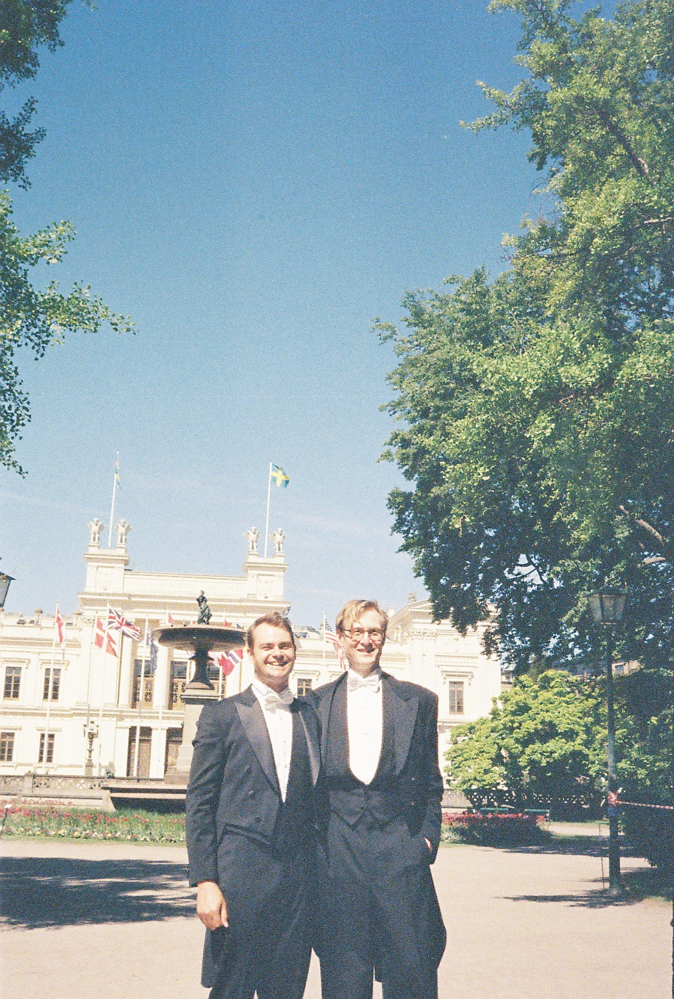{height=590 fig-align="center"}

::::

:::::

::: {.notes}
I'm Jonathan. I'm from South Africa, and I moved to Lund in 2021 to do a PhD in economic history. I want to start with a thank you to the Economic History Department, to Ellen, to Kerstin and Jakob, my supervisors, and to my colleagues, who were around for all four years. [check: say who is in the photo and what the occasion was]
:::

## 👋 Background {.who}

::: {.timeline}
::: {.year style="grid-column: 2 / span 4;"}
2015
:::
::: {.year style="grid-column: 6 / span 4;"}
2017
:::
::: {.year style="grid-column: 10 / span 4;"}
2019
:::
::: {.year style="grid-column: 14 / span 4;"}
2021
:::
::: {.year style="grid-column: 18 / span 4;"}
2023
:::
::: {.year style="grid-column: 22 / span 4;"}
2025
:::

::: {.label style="grid-column: 1; grid-row: 2;"}
Study
:::
::: {.bar .light style="grid-column: 2 / 10; grid-row: 2;"}
Cape Town
:::
::: {.bar .light style="grid-column: 12 / 15; grid-row: 2;"}
Master's
:::
::: {.bar .strong style="grid-column: 15 / 24; grid-row: 2;"}
PhD, Lund
:::

::: {.label style="grid-column: 1; grid-row: 3;"}
Work
:::
::: {.bar .light style="grid-column: 10 / 12; grid-row: 3;"}
FTI
:::
::: {.bar .light style="grid-column: 18 / 24; grid-row: 3;"}
Codera
:::
::: {.bar .strong style="grid-column: 24 / 26; grid-row: 3;"}
Nexer
:::
:::

::: {.notes}
I studied economics in Cape Town, and my first job was as a junior competition economics consultant at FTI in Cape Town in 2019. Then a master's at Stellenbosch, and the PhD at Lund from 2021. During the PhD I did an internship at Fathom in the summer of 2022, and from December 2022 I worked alongside the PhD as a data scientist at Codera. I defended in October 2025, and that same month I started as a data scientist at Nexer in Malmö, which is where I am now.
:::

## ⚡ The PhD {.phd}

### My family left Leicestershire after machines took over stocking knitting

::: {.lede .center-lede}
Enderby [→]{.arrow} London [→]{.arrow} South Africa
:::

::: {.notes}
[SPARE] Why did I care about this topic? The Jayes family were stocking knitters in Enderby in Leicestershire. When knitting was mechanised, that way of life went, and they moved to London and shovelled coal from the barges. Eventually they went to South Africa. So technology displacing people, and creating something different afterwards, is part of how I come to be standing here.
:::

## ⚡ The PhD {.phd}

### My thesis asked what electricity did to people's working lives

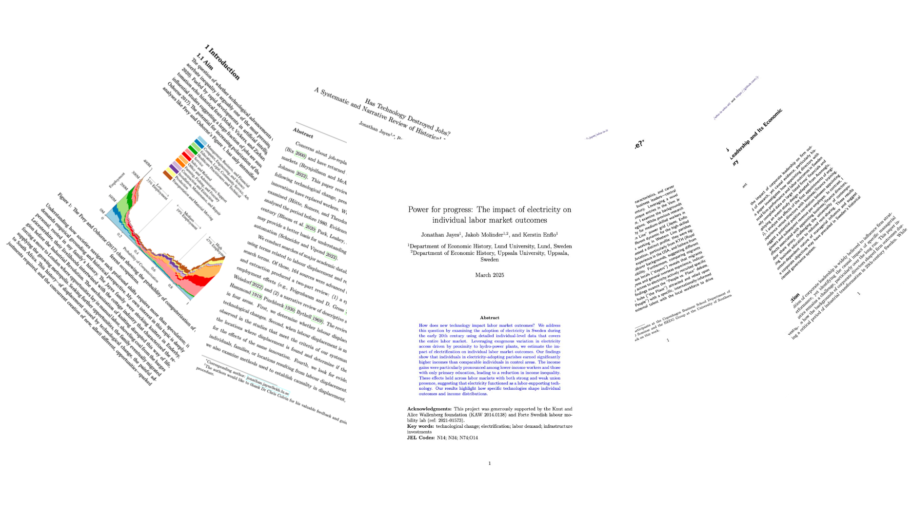{height=520 fig-align="center"}

::: {.source}
*Like moths to a flame: an individual level approach to technological change in 20th century Sweden.* Defended October 2025.
:::

::: {.notes}
My thesis is called Like moths to a flame, and it's four papers about one question: what does a big technological change do to the actual people living through it? I looked at electrification in Sweden. History is one of the few ways to see the full, long-run consequences of a technology, which is why I think it belongs in today's debate on AI and work.
:::

## ⚡ The PhD {.phd}

### Rural Sweden electrified as the top 10%'s income share fell

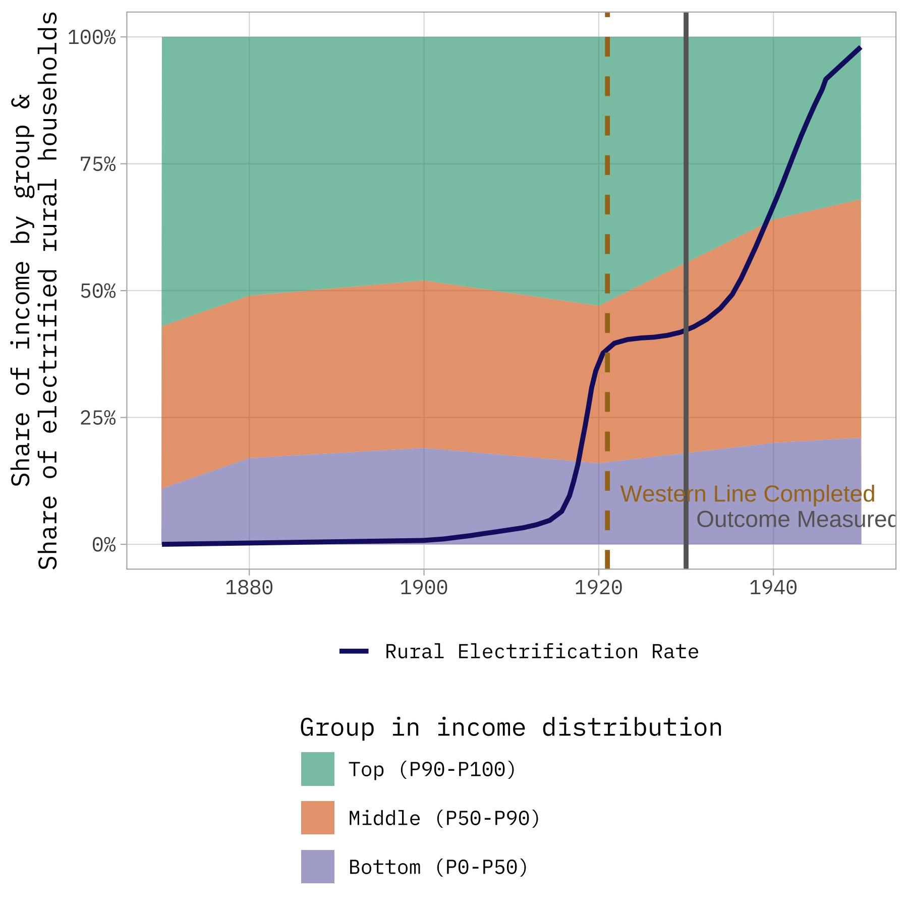{height=540 fig-align="center"}

::: {.source}
Income shares from Bengtsson and Molinder (2021); rural electrification rates from Vattenfall (1948).
:::

::: {.notes}
[SPARE] The dark line is the share of rural households with electricity. It goes from almost nothing around 1915 to nearly 100% by 1950, while the share of income going to the top 10% falls. That's a correlation, and the next slide is how we get closer to a cause.
:::

## ⚡ The PhD {.phd}

### The grid reached Western Line parishes first, through no choice of their own

::::: {.columns}

:::: {.column width="50%"}

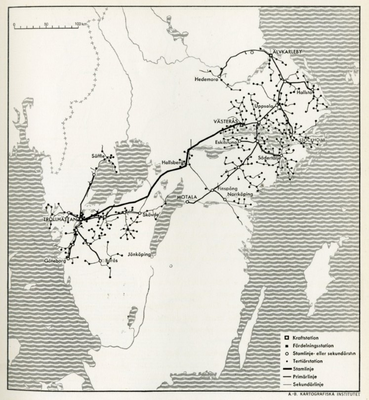{height=520 fig-align="center"}

::: {.source}
The grid in 1922. From Vattenfall (1948).
:::

::::

:::: {.column width="50%"}

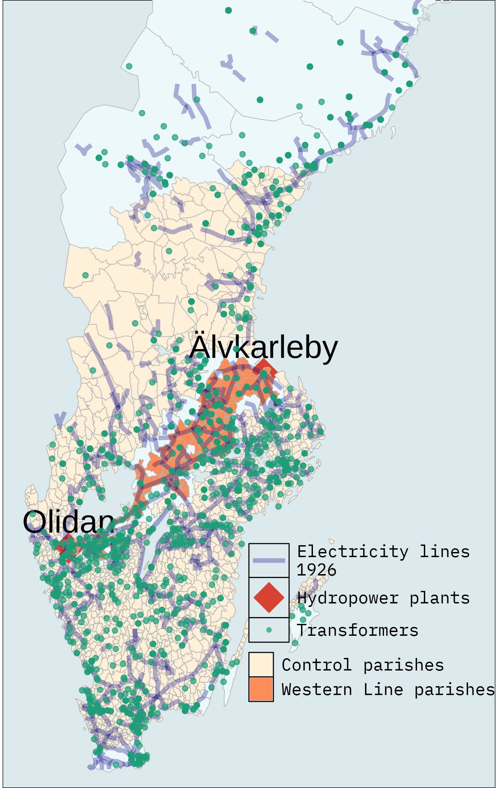{height=520 fig-align="center"}

::: {.source}
Power stations, transformers and parishes, 1926.
:::

::::

:::::

::: {.notes}
This is the map that made the research possible. The Western Line connected two big hydropower plants, and parishes along it got early access to electricity through no action of their own. That gives you something close to a natural experiment. On the right is the data I collected on power stations and transformers, to check that those parishes really did get electricity first.
:::

## ⚡ The PhD {.phd}

### People born along the line earned over 30% more, and lower earners gained most

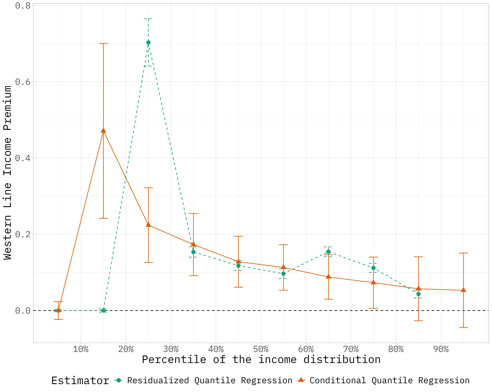{height=560 fig-align="center"}

::: {.source}
Income premium by percentile of the income distribution. Jayes, Molinder and Enflo (2025), *Explorations in Economic History*.
:::

::: {.notes}
The result. By 1930, people born in Western Line parishes earned over 30 percent more than comparable people elsewhere. And look at the shape: the gains are biggest among lower earners and fade towards the top. So in this case a major new technology reduced inequality. It was one country at one time, but it's useful to know when people tell you what AI must do.
:::

## ⚡ The PhD {.phd}

### Early-electrified parishes had fewer farm workers and more factory jobs

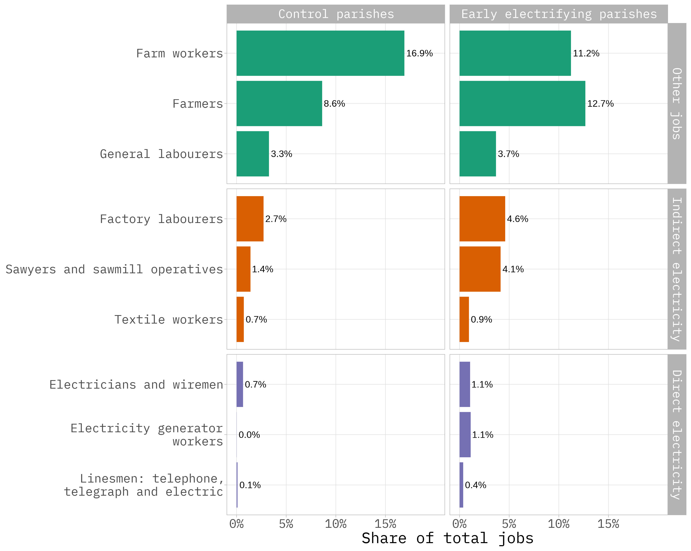{height=570 fig-align="center"}

::: {.notes}
[SPARE] Where did those gains come from? There was no sign of more unemployment. In the early-electrified parishes you see fewer farm workers and more factory jobs, and some entirely new electricity jobs as well, though those stay small.
:::

## 🤖 The PhD {.phd}

### Language models turned printed dictionaries into data on nearly 70,000 people

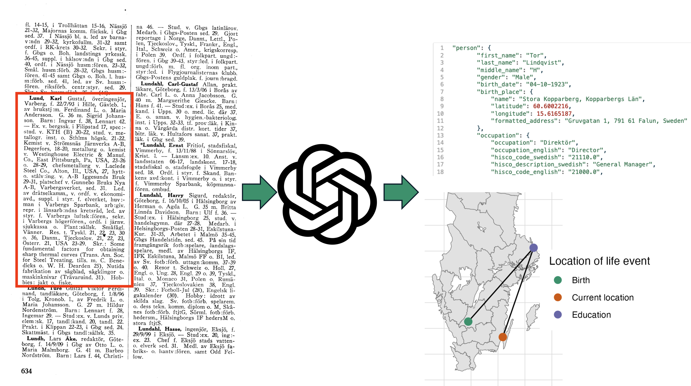{height=560 fig-align="center"}

::: {.notes}
This is the part that changed my career. On the left is a page from a printed biographical dictionary. The red box is one person's whole life in dense abbreviated Swedish. In the middle is a large language model, and on the right is structured data you can link and map. I did this for nearly 70,000 people. By hand it would have been a very long job and I could never have reached that scale. [check: did it save 3 months, or years?]

By the end of my PhD, I was spending my days doing something companies had suddenly become very interested in.
:::

## 🤖 The PhD {.phd}

### The same approach read a century of company annual reports

::::: {.columns}

:::: {.column width="42%"}

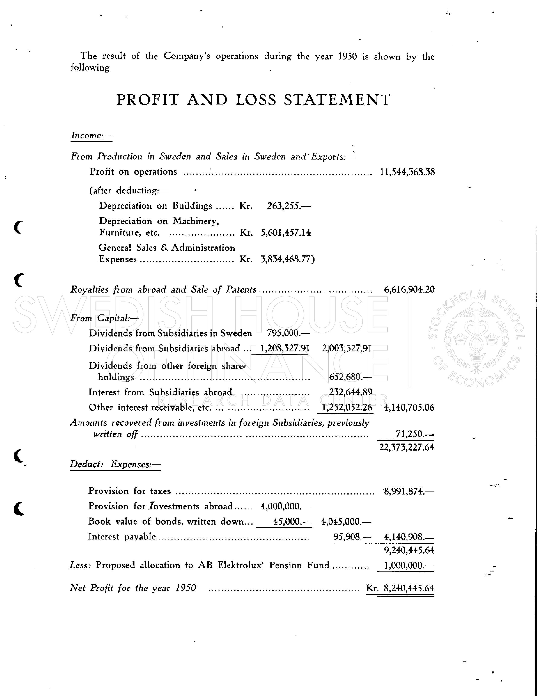{height=540 fig-align="center"}

::::

:::: {.column width="58%"}

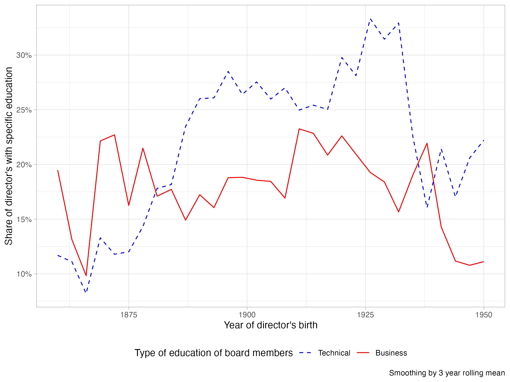{height=500 fig-align="center"}

::: {.source}
Share of board directors with technical or business education, by birth year.
:::

::::

:::::

::: {.notes}
[SPARE] The last paper used the same trick on company annual reports like this one from Electrolux: 71 listed Swedish firms from 1873 to 1980. I matched the directors back to the biographies, which gives you the chart on the right: engineers on boards, and then business school graduates.
:::

## ⚡ The PhD {.phd}

### Each of the four papers needed a different kind of data

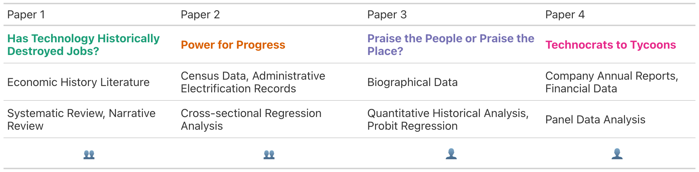{width=1350 fig-align="center"}

::: {.notes}
[SPARE] One thing that was good for me later: each paper needed different data and different methods. A systematic literature review, census microdata, text from biographies, and a panel of company accounts. Two papers were co-authored and two were on my own.
:::

## 💻 Now {.phd}

### I work at Nexer Insight, a data and AI consultancy with 57 people in Sweden

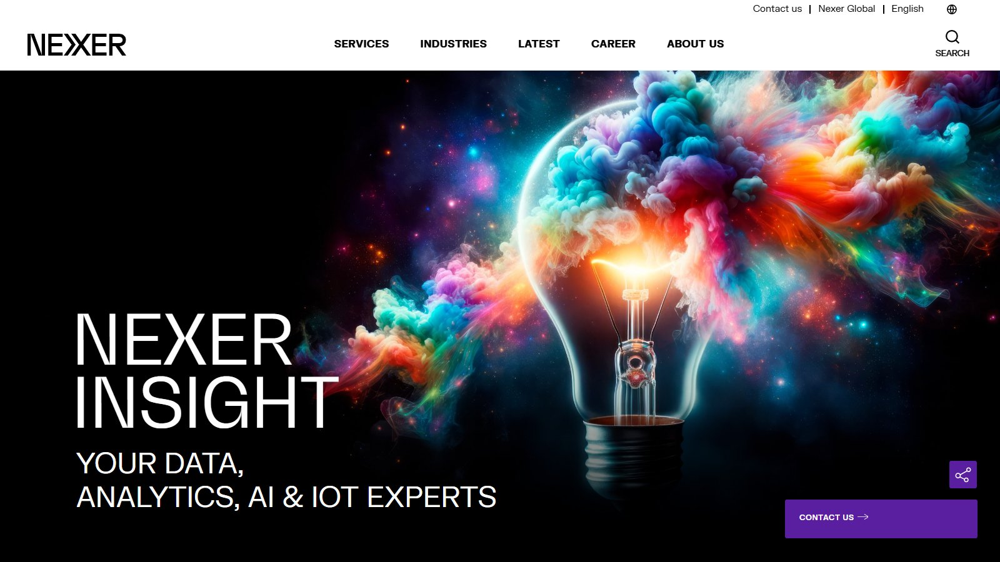{height=570 fig-align="center"}

::: {.source}
nexergroup.com, November 2026. Staff count from Allabolag.
:::

::: {.notes}
Since October 2025 I've worked at Nexer Insight. We do data, analytics, AI and IoT, mostly on Microsoft and Databricks. It's small: 57 people in Sweden, with offices in Gothenburg, Malmö, Stockholm and Örebro, and about 89 million kronor in revenue last year.
:::

## 💻 Now {.phd}

### Nexer Insight is a small part of a family-owned group of 9,500 people

::: {.scale}
::: {.name}
**Danir**
:::
::: {.track}
[]{.fill style="width: 100%;"}
:::
::: {.num}
9,500
:::

::: {.name}
**Nexer Group**
:::
::: {.track}
[]{.fill style="width: 26.3%;"}
:::
::: {.num}
2,500
:::

::: {.name}
**Nexer Insight**
:::
::: {.track}
[]{.fill style="width: 0.6%;"}
:::
::: {.num}
57
:::
:::

::: {.source}
Employees, to scale; Nexer Insight is Sweden only. Allabolag, danir.se, nexergroup.com.
:::

::: {.notes}
Nexer Insight is one of Nexer Group's business areas, with about 2,500 people in 16 countries. Nexer is in turn part of Danir, owned by the Dan Olofsson family, with 9,500 people in 29 countries. Danir also owns Sigma, A Society and PION Group, and, as a South African I enjoy this, Thanda Safari.
:::

## 💻 Now {.phd}

### I am a data scientist at Nexer and mostly write code

::: {.split}
::: {.code}
[70%]{.big} code
:::
::: {.meetings}
[20%]{.big} meetings
:::
::: {.docs}
[10%]{.big} docs
:::
:::

::: {.notes}
So what does the job look like? I'm a data scientist at Nexer Insight in Malmö, and this is roughly how my day splits. About 70% is writing code. About 20% is meetings, and about 10% is making presentations for those meetings and writing documentation. These are my own rough numbers, and it will vary a lot by role.
:::

## 💻 Now {.phd}

### I build AI tools on organisations' own documents

::: {.grid2}
::: {}
**A union**

Answers from internal data
:::
::: {}
**A Swedish region**

A chatbot on its own servers
:::
::: {}
**A legal publisher**

A legal assistant
:::
::: {}
**A corporate office**

AI workshops for admin staff
:::
:::

::: {.notes}
Here are a few of the things I've worked on. For a union, tools so employees can quickly get information out of internal sources. For a Swedish region, a chatbot that can read their documents, deployed locally. For a legal publisher in Stockholm, a legal assistant. And it isn't all code: I've also run workshops on AI adoption with admin staff in a corporate office.
:::

## 🎓 Did it help? {.path}

### The PhD gave me time to get really good at one thing

::: {.trio}
::: {}
Time
:::
::: {}
Depth
:::
::: {}
Working alone
:::
:::

::: {.notes}
So, question two. How much did the PhD matter? It gave me the time and the scope to get really good at something, in my case using AI for archival research. That mattered more than the title. I don't really go by doctor in my day to day. I also learned how to work alone on a tough problem for a long time, which is hard to learn any other way.
:::

## 🎓 Did it help? {.path}

### I would not have got this job straight out of my master's

::::: {.columns}

:::: {.column width="50%"}

::: {.lede}
After the master's
:::

Economics

Stata and R

::::

:::: {.column width="50%"}

::: {.lede}
After the PhD
:::

Language model pipelines

Nearly 70,000 biographies

::::

:::::

::: {.punchline .fragment}
Will that last? Hard to say.
:::

::: {.notes}
I would not have landed my current job straight out of my master's, that's for sure. Honestly, it's a little hard to say whether that kind of problem solving will stay as valuable within data science. But at least when I landed this job last year, it was. [check: is this a fair picture of your skills after the master's?]
:::

## 🗺️ Did it help? {.path}

### Every opportunity since 2022 started with something I did in public

::: {.chain}
::: {.did .fragment fragment-index=1}
Posted on Twitter
:::
::: {.arrow .fragment fragment-index=1}
→
:::
::: {.led .fragment fragment-index=1}
Fathom internship
:::

::: {.did .fragment fragment-index=2}
Kept posting
:::
::: {.arrow .fragment fragment-index=2}
→
:::
::: {.led .fragment fragment-index=2}
Codera
:::

::: {.did .fragment fragment-index=3}
Shared unfinished work
:::
::: {.arrow .fragment fragment-index=3}
→
:::
::: {.led .fragment fragment-index=3}
Talk at SDU
:::

::: {.did .fragment fragment-index=4}
Went to Foo Café
:::
::: {.arrow .fragment fragment-index=4}
→
:::
::: {.led .fragment fragment-index=4}
My boss at Nexer
:::
:::

::: {.notes}
The PhD gave me something to show. This is how people found out about it. I posted things on Twitter during my PhD, and that led to my first internship, at Fathom, in 2022. [check: was it your January 2022 blog post analysing Fathom's tweets?] Twitter led to the job at Codera too.

I also posted about unfinished projects, and kept in touch with researchers at SDU in Denmark, and got invited to talk there. Nobody needed a published paper to find it interesting.

And I went to a meetup in Malmö, Foo Café, a few times during my PhD, and presented at their anniversary. It's also where I met my current boss.
:::

## 🗺️ Did it help? {.path}

### My job interview started as two workshops and an afterwork

::: {.steps}
::: {}
[1]{.n} LinkedIn advert
:::
::: {}
[2]{.n} A message from Foo Café
:::
::: {}
[3]{.n} Two workshops
:::
::: {}
[4]{.n} Afterwork
:::
::: {}
[5]{.n} Two weeks of interviews
:::
:::

::: {.punchline .fragment}
No CV that I can remember.
:::

::: {.notes}
Here's the CV story. I was looking at a job advert on LinkedIn, and I hadn't applied yet. My current boss, who I'd met through Foo Café, saw that and got in touch. I went to the Nexer offices for two workshops, and we went for an afterwork. There were still HR and technical interviews over the next two weeks, so it wasn't only beers. But my boss already knew who I was. The visibility had happened before I needed it.
:::

## 🧭 Leaving academia {.why}

### I chose industry to keep working in Sweden without a gap

::: {.trio}
::: {}
No gap
:::
::: {}
Fast feedback
:::
::: {}
Decent pay
:::
:::

::: {.notes}
You might want to know why I left. My main reason wasn't a grand one. I'm an immigrant in Sweden, and it was very important for me to have an uninterrupted period of working here. So I needed a job that would start right after the PhD, and that pushed me to the private sector. If that's your situation too, please start thinking about it early.

It's also good to get feedback quickly and learn new things. And the pay is okay, but not wildly more than a postdoc. I've built a tool called Lönekrav that shows salaries by occupation in Sweden and the salary floor for a work permit. It's information rather than legal advice. [check: mention only once it's deployed]
:::

## 🧭 Leaving academia {.why}

### The best and worst parts of my job are often the same thing

::: {.tradeoff}
::: {.head}
Gained
:::
::: {.head}
Lost
:::
::: {}
Work stops on Friday
:::
::: {}
Ideas wait for the weekend
:::
::: {}
New people all the time
:::
::: {}
Four years with the same colleagues
:::
:::

::: {.notes}
[SPARE] I don't want to sell you this as paradise. I can turn off the work phone and not think about things until Monday, and that has been great for my mental health. But I have less autonomy during working hours, so if I get fixated on an idea, it happens on nights and weekends. You lose ownership of your ideas, and you rarely go as deep as you did in a PhD.

The one that surprised me is turnover. At Lund I got to know my colleagues and professors well, because they were around for my four years. In a company, people come and go much faster than at a university.
:::

## 🛠️ What I use {.now}

### The same work, with someone waiting for it next week

| In the PhD | At Nexer |
|:---|:---|
| 70,000 biographies | 124,000 legal documents |
| Extraction dashboard | 3,500 hand-checked names |
| The right comparison | 485-question evaluation |
| Teaching Stata | Teaching AI |

::: {.notes}
Question three: what have I used? More than I expected. It's still messy text going in and something useful coming out. In the PhD I structured biographies. Now I run a pipeline that has processed over 124,000 legal documents.

In the PhD I built a dashboard to find where extraction failed. Now we hand-check 3,500 names to test whether personal data is masked properly.

Econometrics taught me to keep asking what the right comparison is. We ran a 485-question evaluation that overturned our own recommendation on which model to use.

And I taught Stata and map-making at Lund, and now I teach people how to use AI tools.
:::

## 🛠️ What I use {.now}

### I learned production engineering on the job, not in the PhD

::: {.trio}
::: {}
Tests
:::
::: {}
Cloud
:::
::: {}
Teams
:::
:::

::: {.notes}
[SPARE] [check: this is my inference from your CV, is it true?] What the PhD did not give me is how to run software for other people: testing, cloud deployment, working on one codebase with a team. I learned that at Codera and Nexer. So if you want to go this way, the research gets you in the door and you learn the rest quickly.
:::

## 📣 Advice {.advice}

### You can start this week, before you feel ready

::: {.lede}
Make a website

Cross-post

Share unfinished work

Have a real interest

Turn up, more than once
:::

::: {.notes}
So what would I do in your position? Make a personal website, because it's something you own. Cross-post to LinkedIn and wherever else, but don't write on LinkedIn only. Share things before they're finished, because that's what got me invited to Denmark. Have a real interest in something. And turn up to something outside your department, more than once.

A caveat: I can trace these links because they worked out. This is one person's story and not a controlled experiment, and as an economic historian I'd be suspicious of it too. But I think it's still worth trying.
:::

## {.statement background-color="#9b479f"}

::::: {.columns}

:::: {.column width="42%"}

### Be visible before you need it.

::: {.links}
How to make your own website:

[blog.jonathanjayes.com](https://blog.jonathanjayes.com/posts/2026-11-12-make-your-own-website)
:::

::::

:::: {.column width="58%"}

::: {.preview}
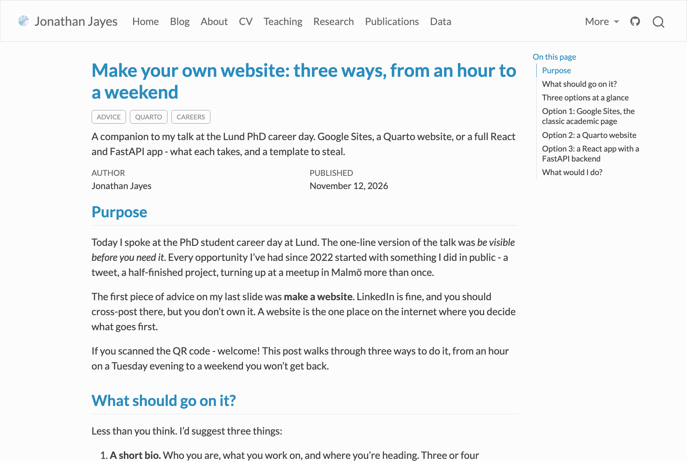{.shot}

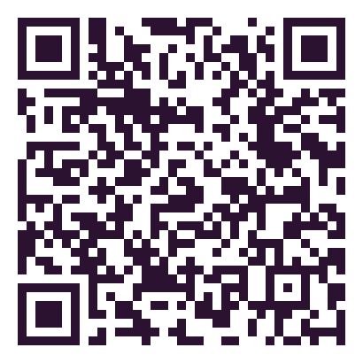{.qr}
:::

::::

:::::

::: {.notes}
You don't need a plan. You just need people to have some idea of what you're interested in by the time you start looking. Thanks very much, and I'd love your questions.
:::
